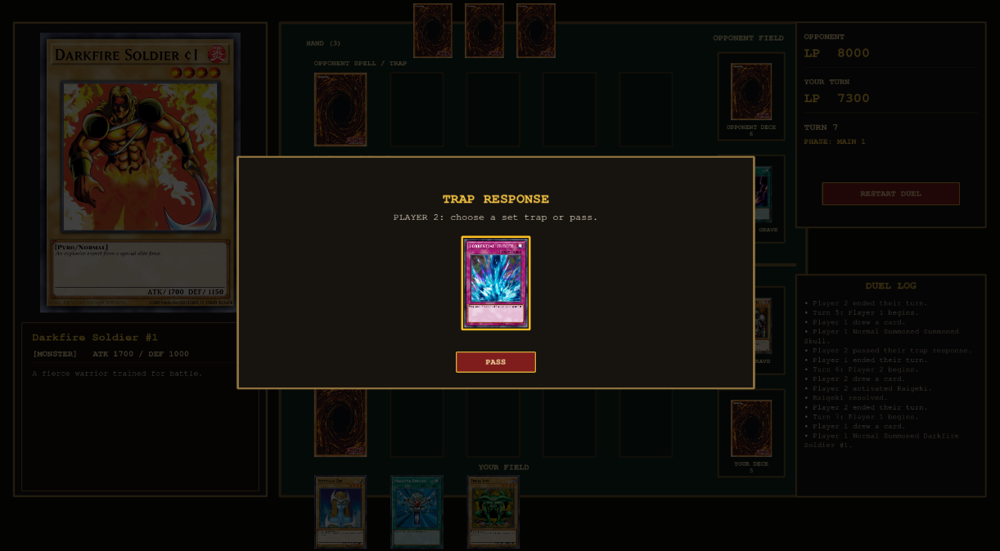

# Yu‑Gi‑Oh! Lite

[English version](#english-version)

> Este projeto foi desenvolvido para a cadeira de Construção de Páginas Web II sob orientação do professor Rodrigo do curso de Sistemas para Internet do Instituto Federal de Educação, Ciência e Tecnologia do Rio Grande do Sul (IFRS), Campus Porto Alegre.

Um **jogo simplificado ao estilo clássico** de Yu‑Gi‑Oh! desenvolvido com **JavaScript**, **Node.js** e **Phaser 4**. Ele roda no navegador, permitindo jogar em qualquer lugar – laptop, tablet ou celular.

---

## 🎮 O que é?

Yu‑Gi‑Oh! Lite captura a **diversão central** do jogo de cartas original, removendo mecânicas mais complexas (Synchro, Xyz, Pendulum, Link). Você obtém:
- Invocações normais, posicionamento de cartas, ativação de Magias/Armadilhas
- Fase de batalha com setas de ataque ao estilo retro dos anos 2000
- Condição de vitória simples (primeiro a reduzir os Pontos de Vida do oponente a 0)
- Um **visual nostálgico dos anos 2000** (playmat pixel art, paleta retro, setas de ataque clássicas)

O jogo é **projetado para manter a lógica independente da UI**, permitindo trocar o núcleo por uma UI completa em Phaser 3 ou até mesmo por uma versão de terminal.

---

## 📚 Como jogar (mesmo que nunca tenha jogado Yu‑Gi‑Oh!)

1. **Cada jogador começa com 8000 Pontos de Vida (PV).**
2. **Deck** – coleção de 40+ cartas. No início cada jogador compra 5 cartas.
3. **Estrutura do turno**
   - **Fase de compra** – compra uma carta.
   - **Fase principal** – você pode:
     - **Invocação normal** de um monstro da sua mão (coloque‑o no campo). Monstros têm ATQ/DEF.
     - **Posicionar** (set) um monstro ou uma Magia/Armadilha virada para baixo.
     - **Ativar** cartas de Magia/Armadilha (ex.: “Buraco Negro” destrói todos os monstros).
   - **Fase de batalha** – declare ataques com seus monstros. Se o ATQ do atacante > ATQ do defensor, o defensor é destruído e o jogador defensor perde PV igual à diferença.
   - **Fase final** – o turno passa ao adversário.
4. **Vitória** – reduza os PV do oponente a 0 ou faça‑o incapaz de comprar uma carta quando necessário.

> **Dica:** o jogo fornece menus e destaques na tela; basta clicar na ação desejada e seguir as instruções.

---

## 🎉 Jogar agora online!

**[Jogar Yu‑Gi‑Oh! Lite](https://guztavo-oliveira.github.io/yugioh-lite/)**

Divirta‑se com o duelo nostálgico! 🎲

---

## 🚀 Executar o jogo localmente

```bash
# Clone o repositório (substitua pela sua URL caso tenha feito fork)
git clone https://github.com/guztavo-oliveira/yugioh-lite.git
cd yugioh-lite

# Instale as dependências
npm install

# Inicie o servidor de desenvolvimento (Vite)
npm run dev
```
Abra `http://localhost:5173` no seu navegador – a tela inicial do jogo aparecerá.

---

## 🎨 Capturas de tela

## Main phase 1


## Battle phase


## Spell card activation


## Trap card activation


---

## 🛠️ Stack

- **Phaser 4** – framework HTML5 para jogos.
- **Vite** – bundler rápido para desenvolvimento e builds de produção.
- **Node.js** – runtime para o servidor de desenvolvimento.
- **ES Modules** – sintaxe moderna `import`/`export`.

---

## 🤝 Contribuindo

Contribuições são bem‑vindas! Sinta‑se à vontade para:
- Corrigir bugs ou melhorar a UI.
- Adicionar novas cartas ou mecânicas (ex.: Fusão, Ritual – mantendo a lógica limpa).
- Polir o tema retro ou adicionar mais animações.

1. Faça um fork do repositório.
2. Crie uma branch de feature (`git checkout -b feature/sua‑feature`).
3. Commit e push das mudanças.
4. Abra um Pull Request.

---

## 📜 Licença

Este projeto está licenciado sob a **MIT License** – você pode usar, modificar e distribuir livremente.

---

## ⚠️ Aviso Legal

Este projeto **não** é afiliado, endossado ou patrocinado por **Konami** ou qualquer outra entidade que possua as marcas registradas de Yu‑Gi‑Oh!™. Todas as artes, imagens de cartas e nomes usados aqui são apenas para fins educacionais e não‑comerciais, sob o conceito de *fair use*.

---

<a name="english-version"></a>

# Yu‑Gi‑Oh! Lite

This project was made for the *Sistemas para Internet* course in the *Construção de Páginas Web II* class at the IFRS institution.

A **simplified, classic‑style** Yu‑Gi‑Oh! trading‑card game built with **JavaScript**, **Node.js**, and **Phaser 4**. It runs in the browser, so you can play it anywhere – on a laptop, tablet, or phone.

---

## 🎮 What is this?

Yu‑Gi‑Oh! Lite captures the **core fun** of the original trading‑card game while stripping away the more complex mechanics (Synchro, Xyz, Pendulum, Link). You get:
- Normal Summons, Set cards, Spell/Trap activation
- Battle Phase with attack arrows (retro 2000‑s style)
- Simple win‑condition (first player to reduce opponent’s Life Points to 0)
- A nostalgic **2000‑s visual theme** (pixel‑art playmat, retro colour palette, classic attack‑arrow graphics)

The **game logic is independent of the UI**, so the same core can later be swapped for a full‑blown Phaser 3 UI or even a text‑based console version.

---

## 📚 How to Play (Even if you’ve never played Yu‑Gi‑Oh!)

1. **Each player starts with 8000 Life Points (LP).**
2. **Deck** – a collection of 40+ cards.  At the start each player draws 5 cards.
3. **Turn Structure**
   - **Draw Phase** – draw one card.
   - **Main Phase** – you can:
     - **Normal Summon** one monster from your hand (place it on the field).  Monsters have ATK/DEF values.
     - **Set** a monster or a Spell/Trap face‑down.
     - **Activate** Spell/Trap cards (e.g., “Dark Hole” destroys all monsters).
   - **Battle Phase** – declare attacks with your monsters.  If an attacker’s ATK > defender’s ATK, the defender is destroyed and the defending player loses LP equal to the difference.
   - **End Phase** – turn passes to the opponent.
4. **Winning** – reduce your opponent’s LP to 0 or make them unable to draw a card when required.

---

## 🎉 Play Now Online!

**[Play Yu‑Gi‑Oh! Lite](https://guztavo-oliveira.github.io/yugioh-lite/)**

Enjoy the nostalgic duel! 🎲

---

## 🚀 Running the Game Locally

```bash
# Clone the repo (replace with your own URL if you forked it)
git clone https://github.com/guztavo-oliveira/yugioh-lite.git
cd yugioh-lite

# Install dependencies
npm install

# Start the development server (Vite)
npm run dev
```
Open `http://localhost:5173` in a browser – you’ll see the game’s start screen.

---

## 🎨 Screenshots

## Main phase 1


## Battle phase


## Spell card activation


## Trap card activation


---

## 🛠️ Tech Stack

- **Phaser 4** – powerful HTML5 game framework.
- **Vite** – fast bundler for development and production builds.
- **Node.js** – runtime for the development server.
- **ES Modules** – modern `import`/`export` syntax.


## 🤝 Contributing

Contributions are welcome! Feel free to:
- Fix bugs or improve the UI.
- Add new cards or mechanics (e.g., Fusion, Ritual – keep the core clean).
- Polish the retro theme or add more animations.

1. Fork the repository.
2. Create a feature branch (`git checkout -b feature/your‑feature`).
3. Commit your changes and push.
4. Open a Pull Request.

---

## 📜 License

This project is licensed under the **MIT License** – you’re free to use, modify, and distribute it.

## ⚠️ Disclaimer

This project is **not** affiliated with, endorsed, or sponsored by **Konami** or any other entity that owns the official Yu‑Gi‑Oh!™ trademarks, artwork, or other intellectual property. All artwork, card images, and names used here are for educational and non‑commercial purposes only and fall under *fair use*.
