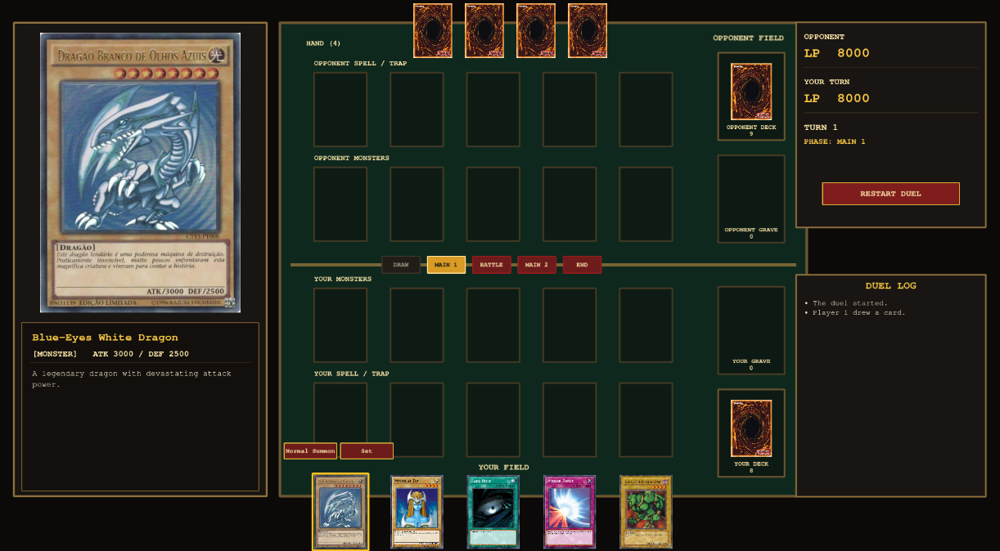
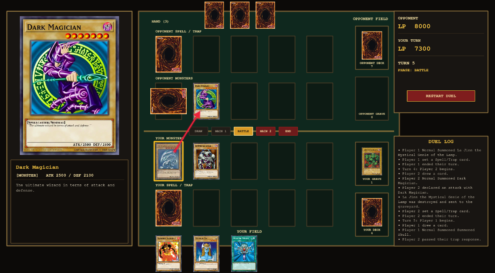
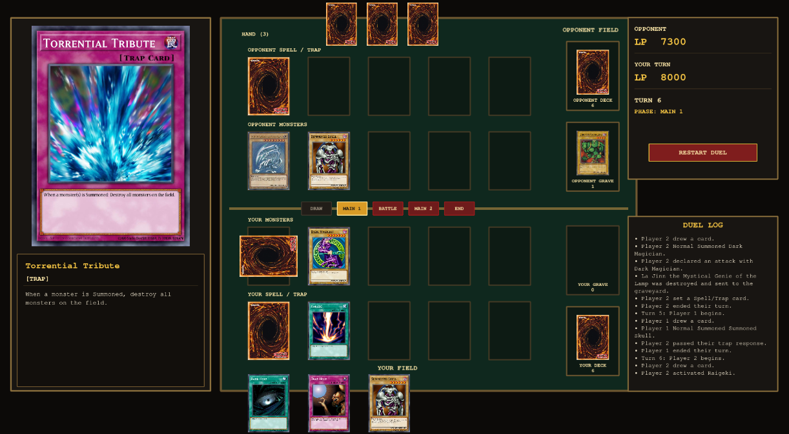

# Yu‑Gi‑Oh! Lite

A **simplified, classic‑style** Yu‑Gi‑Oh! trading‑card game built with **JavaScript**, **Node.js**, and **Phaser 4**.  It runs in the browser, so you can play it anywhere – on a laptop, tablet, or phone.


## 🎮 What is this?

Yu‑Gi‑Oh! Lite captures the **core fun** of the original trading‑card game while stripping away the more complex mechanics (Synchro, Xyz, Pendulum, Link).  You get:
- Normal Summons, Set cards, Spell/Trap activation
- Battle Phase with attack arrows (retro 2000‑s style)
- Simple win‑condition (first player to reduce opponent’s Life Points to 0)
- A nostalgic **2000‑s visual theme** (pixel‑art playmat, retro colour palette, classic attack‑arrow graphics)

It is **engineered to keep the game logic independent of the UI**, so the same core can later be swapped for a full‑blown Phaser 3 UI or even a text‑based console version.

---

## 📚 How to Play (Even if you’ve never played Yu‑Gi‑Oh!)

1. **Each player starts with 8000 Life Points (LP).**
2. **Deck** – a collection of 40+ cards.  At the start each player draws 5 cards.
3. **Turn Structure**
   - **Draw Phase** – draw one card.
   - **Main Phase** – you can:
     - **Normal Summon** one monster from your hand (place it on the field).  Monsters have ATK/DEF values.
     - **Set** a monster or a Spell/Trap face‑down.
     - **Activate** Spell/Trap cards (e.g., “Dark Hole” destroys all monsters).
   - **Battle Phase** – declare attacks with your monsters.  If an attacker’s ATK > defender’s ATK, the defender is destroyed and the defending player loses LP equal to the difference.
   - **End Phase** – turn passes to the opponent.
4. **Winning** – reduce your opponent’s LP to 0 or make them unable to draw a card when required.

## 🎉 Play Now Online!

**[Play Yu‑Gi‑Oh! Lite](https://guztavo-oliveira.github.io/yugioh-lite/)**

Enjoy the nostalgic duel! 🎲

## 🚀 Or Running the Game Locally

```bash
# Clone the repo (replace with your own URL if you forked it)
git clone https://github.com/guztavo-oliveira/yugioh-lite.git
cd yugioh-lite

# Install dependencies
npm install

# Start the development server (Vite)
npm run dev
```
Open `http://localhost:5173` in a browser – you’ll see the game’s start screen.


## 🎨 Screenshots

## Main phase 1


## Battle phase


## Spell card activation


## Trap card activation


---

## 🛠️ Tech Stack

- **Phaser 4** – powerful HTML5 game framework.
- **Vite** – fast bundler for development and production builds.
- **Node.js** – runtime for the development server.
- **ES Modules** – modern `import`/`export` syntax.

---

## 🤝 Contributing

Contributions are welcome!  Feel free to:
- Fix bugs or improve the UI.
- Add new cards or mechanics (e.g., Fusion, Ritual – keep the core clean).
- Polish the retro theme or add more animations.

1. Fork the repository.
2. Create a feature branch (`git checkout -b feature/your‑feature`).
3. Commit your changes and push.
4. Open a Pull Request.

---

## 📜 License

This project is licensed under the **MIT License** – you’re free to use, modify, and distribute it.


## ⚠️ Disclaimer

This project is **not** affiliated with, endorsed, or sponsored by **Konami**, **Bandai**, **Nintendo**, or any other entity that owns the official Yu‑Gi‑Oh!™ trademarks, artwork, or other intellectual property. All artwork, card images, and names used here are for educational and non‑commercial purposes only and fall under *fair use*.
